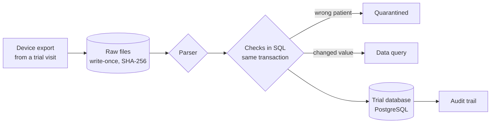

# medical-device-clinical-data

When a medical device is in a clinical trial, every measurement from every visit has to land in the right patient's record, unchanged, with a reason for every correction. A prototype I am building to explore that for an implantable electrode array, on synthetic data (100 subjects, 4 sites). Work in progress.

Companion project: [medical-device-bench-data](https://github.com/Tianyi-2000/medical-device-bench-data) covers the earlier stage, R&D bench testing.

## How data flows



## What it shows

- Loading the same files twice changes nothing. A resent file with a different value raises a data query instead of overwriting.
- A file for the wrong patient is quarantined whole. A changed unit or format rejects the file.
- Every correction needs a reason. The database writes the audit trail, and no application role can edit it.
- A locked visit can't be changed until it is unlocked with a reason.
- Every test names the requirement it verifies.

## Try it

Needs Docker and [uv](https://docs.astral.sh/uv/).

```bash
make up && make db && make seed && make load   # PostgreSQL 17, schema, synthetic trial, load
make planted   # five problem files: skipped, conflict, quarantined, row rejected, file rejected
make test      # pytest on a throwaway database
```

## More

- [Design details](docs/DETAILS.md): all make targets, how a file is loaded, design decisions, known limitations
- [Requirements](docs/requirements.yaml)

*A prototype for learning, not a validated system (no 21 CFR Part 11 validation). All data is synthetic.*
